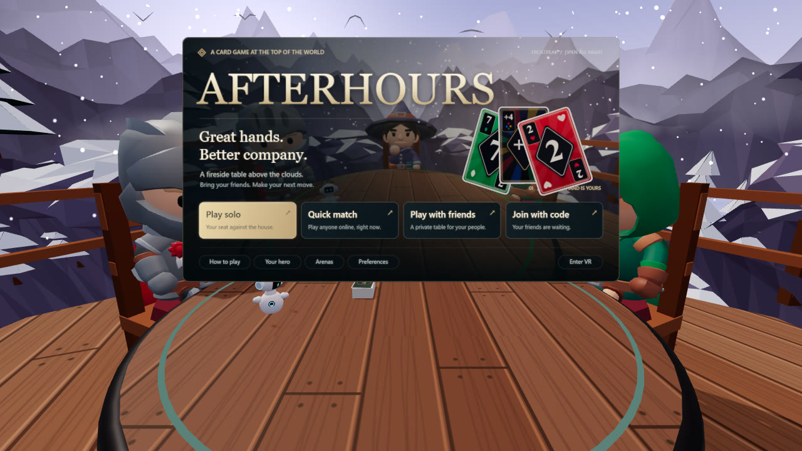
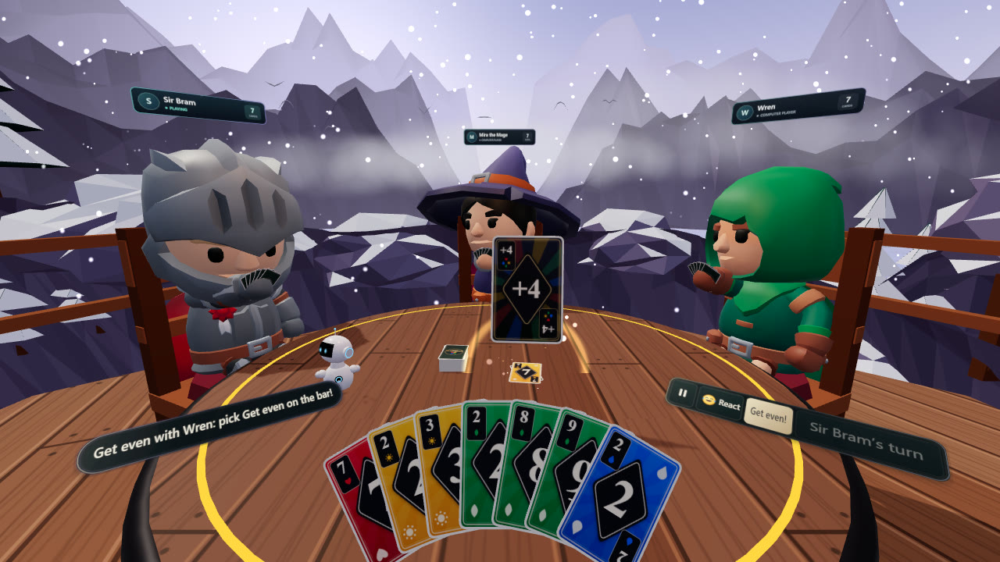

# AFTERHOURS — The Card Lounge

A social VR card game built with Meta's **Immersive Web SDK (IWSDK 1.1.0-rc.2)**, TypeScript and Three.js. Play solo against bots or host a room that friends join with a code. The setting is Frostpeak, a snowy mountain deck with stylized heroes at the table, and three more arenas. Play is hands-first: pinch, point or, on Meta VR Glasses, look and pinch.

This repository contains only the card game. The earlier F1 and island prototypes are separate and are not included.



**Submitting, or picking this up on another machine? Read [START_HERE.md](START_HERE.md) first.**

## Continue on Windows with Claude

Start with **[WINDOWS_SETUP.md](WINDOWS_SETUP.md)**. **[HANDOFF.md](HANDOFF.md)** contains the project context, current architecture, visual direction and unfinished work. Claude Code reads that context through `CLAUDE.md`.

After installing Git, Git LFS and a supported Node.js version:

```powershell
git lfs install
git clone https://github.com/Siddhanthkjain2005/VR.git
cd VR
git lfs pull
npm run setup
npm run dev:all
```

`setup` installs the locked dependencies and checks the project. `dev:all` starts the multiplayer backend and the SDK-managed game preview. The preview URL is normally **https://localhost:8081/**. Solo play also works without the backend. The pinned Node version is in `.nvmrc`; Node 22.23.2 is the development baseline.

The same npm commands run in Windows PowerShell, macOS and Linux. Blender, Python, paid AI services and plugins are **not required to run the game**. Exported models and textures are included. The larger editable `.blend` sources use Git LFS.

## Current features

- Solo play with bots; multiplayer room codes, lobby/ready controls, reconnect and rematch.
- Online play with or without a server: with the game server running, rooms live there; without one (plain file hosting, or `npm run dev`), **Play with friends** hosts the table in your browser and friends anywhere join with the same code, connected directly (WebRTC; see [Online play](#online-play)).
- Colour/symbol matching, Skip, Reverse, Draw Two, Wild and Wild Draw Four. [Exact rules](RULES.md).
- Desktop clicks and immersive hands/controllers. Pinch a card, carry it and release it over the discard area.
- Visible faces, attached card fans, blinks, gaze, breathing and reactions; headsets removed from faces.
- Wide animated launch menu, dark veined marble, close 3D furnishings, rain/mist and distant light motion.
- Floating +4 card, energy ribbons/rings, gold victory confetti/crown and defeat/rematch effects.
- Voice/signalling implementation, emotes, optional toy pranks, reduced-motion/flashing preferences and MR controls.



The distant penthouse is **generated photographic architecture on a background plane**, with limited parallax. Players, chairs, close props, floor, table, cards and effects are live 3D. This is not a fully modelled photoreal room. See [asset provenance](blender/penthouse-art-provenance.md) and [current verification/limitations](STATUS.md).

## Useful commands

```powershell
npm run doctor           # Check Node, dependencies and required game assets
npm run dev:all          # Game preview + multiplayer backend
npm run dev             # Frontend preview only, managed by IWSDK
npm run server          # Multiplayer backend only, port 2567
npm run check           # Full local checks and production build
npm test                # Rules + live multiplayer server tests
npm run test:interaction # Hand/card geometry and release checks
npm run build           # Production client in dist/
npm start               # Built client + backend on port 8080
npm run dev:down         # Stop SDK preview
```

For development, use the IWSDK-managed launcher; do not start a separate raw Vite server. The dev proxy forwards `/chaos-ws` (and `/chaos/health`) to the backend. Production WebXR and microphone access require HTTPS; `npm start` is a local HTTP smoke test, not an HTTPS deployment.

## Online play

Three ways to play online, from the title screen:

- **Quick match**: sit at a public table with whoever else is online. It deals when its 20-second countdown ends (computer players take any empty seats), when four people are seated, or as soon as everyone seated presses Ready. Public tables play with Stack +2/+4. Needs the game server.
- **Play with friends** / **Join with code**: a private table and its 5-letter code.

### Free, always-on server (Cloudflare, free plan)

**Live now: <https://afterhours.chaos-table.workers.dev>** (deployed 2026-11-15; open it on a PC or in the Quest browser).

The game and its online play deploy together to Cloudflare Workers with Durable Objects, which the free plan includes. Nothing to keep running, and players get one HTTPS address (it works in the Quest browser):

```powershell
npx wrangler login   # once: sign in to (or create) a free Cloudflare account in the browser
npm run deploy       # builds the game and publishes it to https://afterhours.<your-subdomain>.workers.dev
```

The Worker (`cloud/worker.ts`, config `wrangler.jsonc`) serves the built game as static files (free and unmetered) and runs each table as a Durable Object with the same room code as the Node server (`shared/room.ts`); a Matchmaker object hands out public tables. Free plan limits: 100,000 requests a day and 13,000 GB-s a day of table time (about 29 hours of open tables a day), plenty for a hackathon. To stay well inside them, VR head and hand presence goes out at 12 updates a second and only while someone moves.

`npm run cloud:dev` runs the same thing locally (the real Workers runtime, at http://127.0.0.1:8787), and `node scripts/cloud-smoke.mjs <address>` checks any deployment or server: health, a private table with a friend, a deal, a move, Quick match pairing, a public table dealing with computers, and refused codes.

### What the built site ships

`npm run build` leaves the Penthouse world out: it seats 3D scans of real people, which the competition rules do not allow, and its files are 56 MB. `VITE_PENTHOUSE=1 npm run build` (or `npm run dev` with the same variable) brings it back for local use. The build then needs about 1 MB before the title appears. The title's Mixed reality button is left out the same way unless the build sets `VITE_MIXED_REALITY=1`: that mode plays the same game over passthrough without reading the room, which the competition's judging marks down.

### How the game picks a route

**Play with friends** checks for the game server first (`/chaos/health`, 2.5 s):

- **Server found** (`npm run dev:all`, `npm start`, or a deployment with the backend): the room lives on the server. Sturdiest: seats are held for 90 s if someone drops, and the table carries on if the host leaves.
- **No server** (`npm run dev`, or the built `dist/` on any static host such as GitHub Pages): your browser hosts the table. Friends type the same 5-letter code under **Join with code** and connect straight to your browser. The players find each other through public Nostr relays ([Trystero](https://github.com/dmotz/trystero), MIT); only encrypted connection offers pass through them, and the game itself flows browser to browser. The host has to keep the game open; when the host leaves, the table closes for everyone.

Joining tries the server first and falls back to a browser-hosted table with that code. `?net=direct` or `?net=server` in the address forces one route. A few strict networks (some offices, mobile hotspots) block direct connections; a TURN relay fixes that: set `VITE_TURN_URLS` (comma-separated `turn:` URLs), `VITE_TURN_USER` and `VITE_TURN_CREDENTIAL` when building. Friends on other networks also need the game itself at a public HTTPS address (any static host works for the direct mode).

## Where things live

| Area | Files |
|---|---|
| Game flow, menus, timeline | `src/game/app.ts`, `src/game/ui.ts` |
| Hands, card picking, deck/discard | `src/game/tabletop.ts` |
| Characters and skeleton animation | `src/game/people.ts`, `src/game/avatars.ts` |
| Room, lighting, effects | `src/game/env.ts`, `src/game/vfx.ts`, `src/scene-assets/` |
| SDK/headset bridge and responsive framing | `src/chaos-system.ts` |
| Rules and authoritative table host | `shared/` |
| Multiplayer: shared room logic | `shared/room.ts` |
| Multiplayer: server (WebSocket) / direct (WebRTC) | `server/`, `src/game/p2p.ts`, `src/game/net.ts` |
| Models, textures, active scene | `public/models/`, `public/textures/`, `public/scenes/` |
| Editable Blender scenes and exports | `blender/` |

## Tools and credits

**[TOOLS_AND_PLUGINS.md](TOOLS_AND_PLUGINS.md)** lists the Windows/Claude integrations and verified installation links. Start with IWSDK's tools and Blender; additional services are optional.

Imported assets retain their creators' licences: the existing project credits Renderpeople's Nathan/Sophia/Carla scans and nghihuutr's sofa as CC BY 4.0, and Poly Haven plants/materials as CC0. These are not original project assets. Source details and remaining attribution checks are recorded in [ASSET_CREDITS.md](ASSET_CREDITS.md). AI-generated environment/marble provenance is in `blender/penthouse-art-provenance.md`. No project-wide open-source licence has been chosen for the original code.
